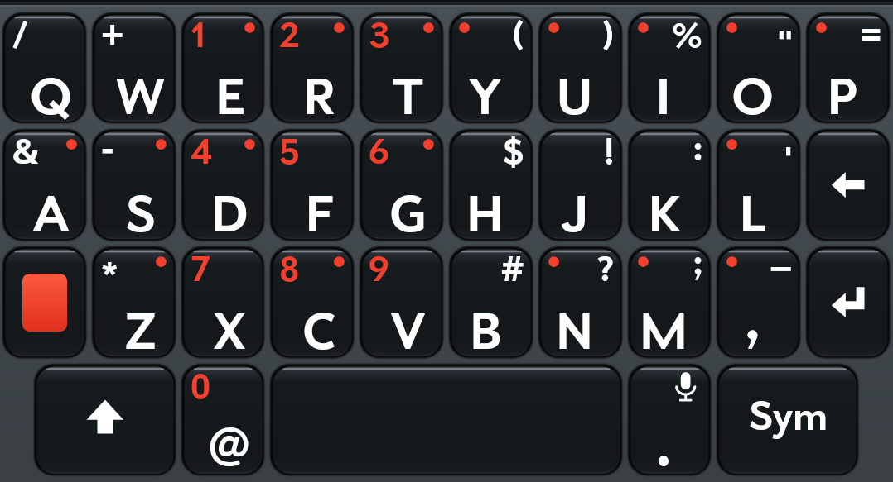
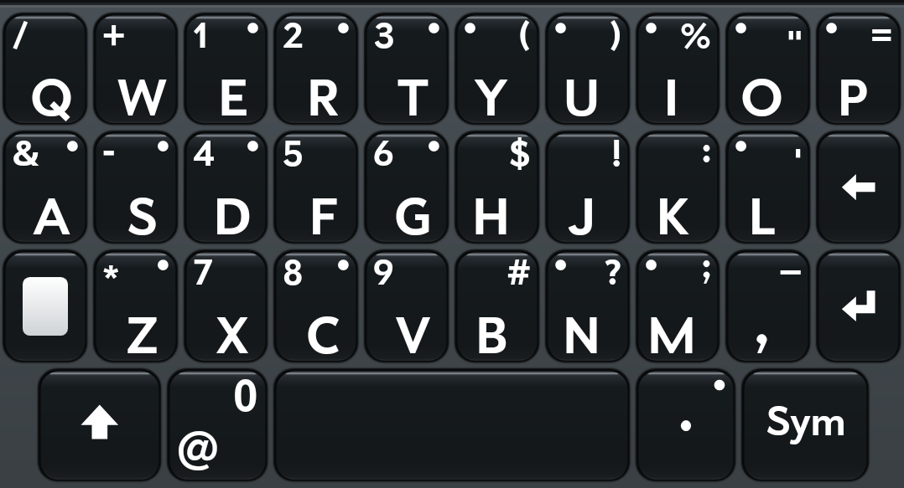
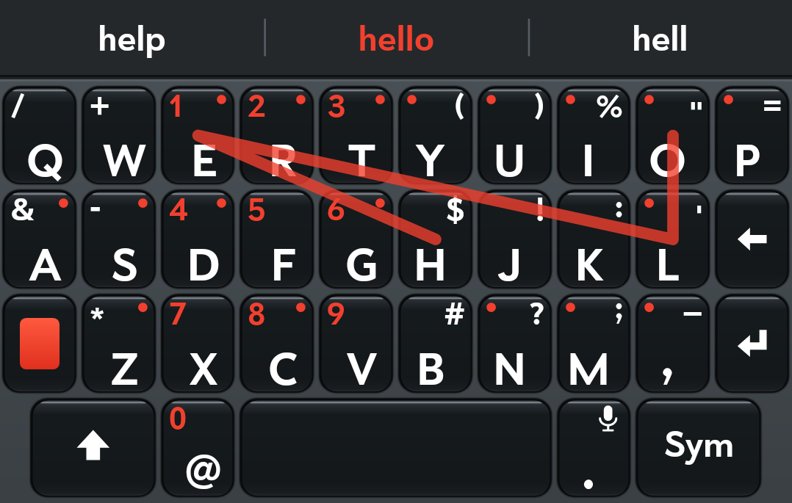

# Pre Keyboard

The Palm Pre's keyboard, for Android. Key for key the Pre's layout - four rows of ten in
matching columns, the orange key, Sym, and every key's alternate printed where the Pre printed
it - in two styles:

| Orange | White |
|---|---|
|  |  |

**Orange** prints the digits and the orange key in orange, as on the Pre. **White** prints
everything white. Hold the orange key to switch between them at any time.

It began as the "Pre (Orange)" and "Pre (White)" layouts of
[LuneOS's keyboard](https://github.com/webOS-ports/webos-keyboard), and the idea of bringing a
webOS keyboard to Android comes from [Lunacy](https://github.com/webOSArchive/Lunacy)'s
TouchPad keyboard. It shares no code with either.

## Features

- The Pre's layout key for key: four rows in matching columns, the orange key, Sym, and every
  key's alternate printed where the Pre printed it
- Two styles, **Orange** and **White**: hold the orange key to switch on the fly
- **Swipe to type**, with the word you would get shown as you swipe, and the next likeliest
  guesses one tap away
- **Suggestion bar**: three words above the keys, the likeliest in the middle in orange
- **Autocorrect** for typos and for contractions (`dont` → `don't`), undone by the next
  backspace, and learning the words you keep
- **Double-space period**
- **Emoji**: every emoji your phone can draw, by category, with your recent ones first
- **Accents** on a long press of a letter
- **Cursor control**: hold the space bar and slide; with shift on, it selects
- The **globe** asks which keyboard to use
- Shift lights orange whenever the next letter will be a capital
- Small, Medium and Large heights
- Every setting takes effect at once, with the keyboard still on screen
- Built for Android 15, runs on Android 5.0 and later



## Typing on it

- **Orange key**: tap, and the next key types its printed alternate (orange + E = 1). Double tap
  to lock it on; tap again to let go. **Shift** works the same way, and lights orange while
  the next letter will be a capital. Hold the orange key to switch between the Orange and White
  styles.
- **Sym** opens the digits and symbols. On that page, the **globe** asks which keyboard to use
  and the **smiley** opens the emoji (hold it for the text emoticons, `:-)` and friends).
- **Emoji**: every emoji your phone can draw, by category, with your recent ones first.
  Scroll the grid, or tap a category along the bottom.
- **Hold a letter** for its accents: slide to the one you want and let go.
- **Hold the space bar** and slide: the cursor follows your finger, left and right a character
  at a time, up and down a line at a time. With shift on, it selects as it goes.
- **Hold backspace** and it repeats, then starts taking whole words.
- **Swipe** (when switched on): slide across the letters and lift at the end of the word. The
  word goes in, spaced from the one before. While you swipe, the bar shows the word you would
  get if you lifted now, in orange; after, it offers the next likeliest
  guesses, and tapping one swaps it in. Backspace straight after a swipe takes the whole word.
  Taps still type letters as usual.

## Settings

Open **Pre Keyboard** from the app drawer. Everything there takes effect at once, even with
the keyboard on screen.

- **Style**: Orange or White.
- **Height**: Small, Medium or Large rows.
- **Autocorrect** (on by default): fixes typos when you finish a word, and puts the apostrophe
  in contractions - `dont` becomes `don't`, `im` becomes `I'm`, a lone `i` becomes `I`. Words
  that are real words as they are (`well`, `were`, `its`, `ill`) are left alone. Backspace
  straight after a correction puts back what you typed, and the keyboard remembers that word
  from then on. It stays out of passwords, email addresses and web addresses.
- **Double-space period** (on by default): two quick spaces after a word type `. `.
- **Suggestion bar** (off by default): three words above the keys as you type. The middle one,
  in orange, is the likeliest - what the space bar would make of your word. On the left is the
  word as you typed it, when that differs; tap it to keep it, and it is never corrected again.
- **Swipe to type** (off by default): see above. It brings the suggestion bar with it.

Swipe matching follows the location channel of Kristensson and Zhai's SHARK² (2004): the
finger's path is compared, point for point, with each candidate word's path through its keys,
and the distance is weighed against how common the word is.

## Installing

Pre Keyboard isn't on an app store. Download the APK from
[Releases](https://github.com/alan-morford/prekeyboard/releases), or build it (below), then:

1. Install the APK (allow your browser or file manager to install apps when Android asks).
2. Open **Pre Keyboard** and follow its two steps: switch it on in Android's keyboard settings,
   then choose it.

Over `adb`:

```sh
adb install -r app/build/outputs/apk/debug/app-debug.apk
adb shell ime enable io.github.alan_morford.prekeyboard/.KeyboardService
adb shell ime set io.github.alan_morford.prekeyboard/.KeyboardService
```

Android 5.0 and later; built for Android 15.

## Building

JDK 17 or later and the Android SDK (platform 35):

```sh
./gradlew :app:assembleDebug          # app/build/outputs/apk/debug/app-debug.apk
./gradlew :app:testDebugUnitTest      # typing, autocorrect and rendering checks
```

The tests run on the JVM with Robolectric, which draws the real keyboard: they leave
screenshots of every page in `app/build/shots/`.

The word list and the emoji list are generated and checked in, so a build needs no network.
To regenerate them:

```sh
python3 tools/build_dictionary.py <scowl>/final en_50k.txt app/src/main/assets/dictionary.txt
python3 tools/build_emoji.py emoji-test.txt app/src/main/assets/emoji.txt
```

(SCOWL from http://wordlist.aspell.net/, `en_50k.txt` from
[FrequencyWords](https://github.com/hermitdave/FrequencyWords), and `emoji-test.txt` from
https://unicode.org/Public/emoji/.)

## The typeface

The Pre printed its keys in **Prelude**, and this keyboard uses it when it is there - but
Prelude belongs to HP, and its licence allows it on webOS devices only, so it is not in this
repository and the keyboard falls back to Android's bold sans. To build with Prelude for your
own use:

```sh
tools/fetch-prelude.sh                # puts Prelude-Bold.ttf in app/src/main/assets/fonts/
```

An APK built that way contains the font, so keep it to yourself.

## Licence

Apache 2.0 - see [LICENSE](LICENSE). The word list is CC BY-SA 4.0 and the emoji list is under
the Unicode License; see [NOTICE](NOTICE).
