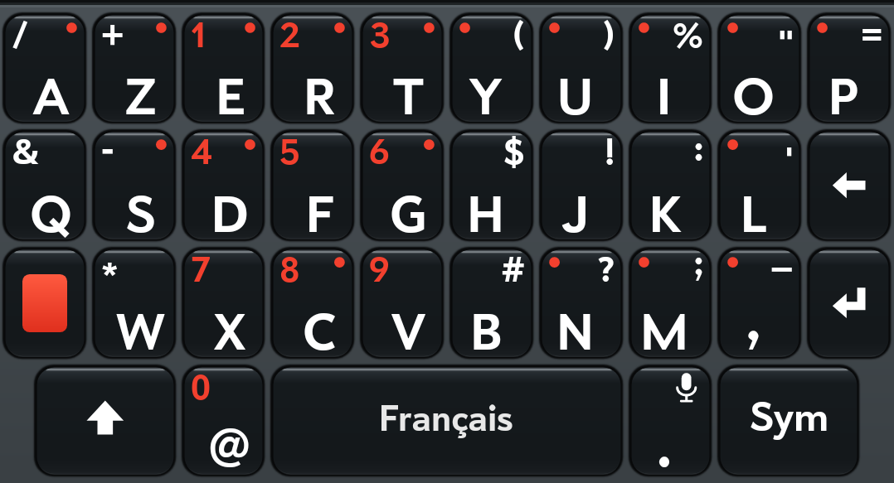

# Pre Keyboard

The Palm Pre's keyboard, for Android. Key for key the Pre's layout - four rows of ten in
matching columns, the orange key, Sym, and every key's alternate printed where the Pre printed
it - in two styles:

| Orange | White |
|---|---|
|  |  |

**Orange** prints the digits and the orange key in orange, as on the Pre. **White** prints
everything white. Hold the globe on the Sym page to switch between them at any time.

It types in **English** (US, UK, Canada and Australia), **French**, **German**, **Spanish**,
**Italian**, **Dutch**, **Portuguese**, **Czech**, **Polish**, **Hungarian**, **Danish**,
**Norwegian**, **Swedish**, **Finnish**, **Russian**, **Ukrainian**, **Arabic** and **Hebrew**,
each with its own keys, dictionary and suggestions, and in **Simplified Chinese** by pinyin. Check the ones you use in the app, then flick the space bar left or right to
switch between them; see [Languages](#languages).

It began as the "Pre (Orange)" and "Pre (White)" layouts of
[LuneOS's keyboard](https://github.com/webOS-ports/webos-keyboard), and the idea of bringing a
webOS keyboard to Android comes from [Lunacy](https://github.com/webOSArchive/Lunacy)'s
TouchPad keyboard. It shares no code with either.

## Features

- The Pre's layout key for key: four rows in matching columns, the orange key, Sym, and every
  key's alternate printed where the Pre printed it
- Two styles, **Orange** and **White**: hold the globe on the Sym page to switch on the fly
- **Languages**: 21 of them, each with its own keys, words and suggestions, Simplified
  Chinese by pinyin among them; check the ones you use and flick the space bar left or right
  to change
- **Swipe to type**, forgiving of quick, rough swipes, with the word you would get shown as
  you swipe, and the next word predicted after
- **Suggestion bar**: three words above the keys, the likeliest in the middle in orange, and
  if you like, an emoji for the word on the right (`pizza` → 🍕)
- **Next-word suggestions**: before you start a word, the bar offers the three likeliest next
  words (`I` → `don't`, `think`, `know`), learning the ones you use
- **Your own words**: hold a word in the bar to add it to the dictionary, or hold one it
  already knows to delete it (`yest`, `om`); see, add, remove or put back words in the app.
  Words keep their capitals: save `webOS` and typing `webos` becomes `webOS`
- **GIFs and stickers** from [KLIPY](https://klipy.com), next to the emoji: trending or
  searched for, moving as you scroll, sent straight into the app
- **Speech input**: hold the period and talk
- **Paste**: copy or cut something and a clipboard icon waits in the bar's right-hand place
  until you tap it to paste
- **Fix a word**: tap a word in the text and the bar offers what else it might be (`ball` →
  `bell`, `bill`, `bull`); tap one and it takes the word's place. (A word autocorrect
  changed switches back to what you typed instead; see Autocorrect.)
- **Autocorrect** for typos, for contractions (`dont` → `don't`) and for words run together
  (`theynare` → `they are`), each change marked with an orange dashed underline and a light
  buzz. Tap the underlined word to switch between what you typed and the correction (and,
  showing what you typed, hold it to add that to your dictionary); backspacing into it puts
  back what you typed first
- **Vibrate on keys** (light, firmer or strong) and **Sound on keys**, if you like: a tap or a click as each key goes down
- **Double-space period**, and punctuation that brings its own space
- **Emoji**: every emoji your phone can draw, by category, with your recent ones first
- **Hold for more**: accents and extra symbols on a long press, each such key marked with a
  dot (switch it on in the app, or hold the orange key)
- **Cursor control**: hold the space bar and slide; with shift on, it selects
- The **globe** asks which keyboard to use; hold Return on the Sym page to open the app
- Shift lights orange whenever the next letter will be a capital, and the bar's words follow
  it: a capital first, or all capitals with caps lock
- **Crash reports**: if the keyboard ever crashes, it offers to email what went wrong (nothing
  you typed) next time it comes up
- Small, Medium and Large heights
- Every setting takes effect at once, with the keyboard still on screen
- **Updates itself**: it looks for a new release once a day and offers it above the keys
- Built for Android 15, runs on Android 5.0 and later


## Typing on it

- **Orange key**: tap, and the next key types its printed alternate (orange + E = 1). Double tap
  to lock it on; tap again to let go. **Shift** works the same way, and lights orange while
  the next letter will be a capital. Hold the orange key to turn **Hold for more** on or off.
- **Sym** opens the digits and the symbols the letters page doesn't have: `[ ] { } < > ^ ~ |`,
  `` \ ` ° £ × ÷ ± ≠ ¡ ``, nothing repeated from the letters but the period. With Hold for more
  on, hold a key for more still: curly quotes on `` ` ``, `« » ≤ ≥` on `<` and `>`,
  currencies on `£`, `√ ∞` on `÷`, superscripts and fractions on the digits, and on the
  letters page the long and short dashes `— –` on S. On the Sym page, `¬` is held on `|`, the
  **globe** asks which keyboard to use (hold it to switch between the Orange and White
  styles) and the **smiley** opens the emoji (with Hold for more on, hold it for the text
  emoticons, `:-)` and friends).
- **The bottom row** sits on the same grid as the keys above: shift and Sym the same size at
  either end, `@` one key wide under X with its `0` printed where the `7` is above it, then
  the space bar, and the period under I, K and M. The Sym page's bottom row matches it key for
  key, so nothing moves under your thumb when the page changes: the globe where shift is, the
  smiley where `@` is, the period (with its microphone) where the period is, and ABC where Sym
  is, so the same spot takes you there and back. Backspace and Return keep their places too, at
  the right-hand end of the middle rows. Hold the Sym page's Return (the one with the gear) to
  open the Pre Keyboard app.
- **Number pad**: a field that only takes numbers (a PIN, a code, an amount, a phone number,
  a date) gets big digits three across, as on a phone's dial pad, in the style's colours,
  with backspace, 0 and Return along the bottom. Whatever else the field can take is held on
  the 0: `+ * #` for phone numbers, a minus or a decimal point, `/` and `:` for dates and times.
- **Period** (and `, ; : ! ?`): it brings a space with it. Backspace straight after takes just
  the space; a space typed out of habit isn't doubled; `?`, `,` or another period go against
  the word, so `...` and `?!` stay together. No space in numbers (`3.14`, `1,000`, `10:30`),
  web or email addresses (`https:`), or fields that aren't for words.
  It sits in the column of I, K and M, with a microphone in its corner.
- **Speech input**: hold the period, on either page (a tap is always just a period). The
  microphone lights up in a white disc and the bar says "Listening…"; the words go into the
  field as you say them. Tap the bar (or hold the period again) to stop; a pause stops it
  too, and typing any key does. The first time, Android asks to let Pre Keyboard use the
  microphone. It uses the phone's own speech recogniser (Google's, on most phones).
- **Punctuation after a space**: typed a space, then decided on a comma? `, . ? ! : ;` typed
  straight after the space go against the word and the space moves after them (`word ,` →
  `word, `).
- **Emoji, GIFs and stickers**: the smiley opens a page with **ABC**, **Emoji**, **GIF** and a
  sticker along the top. Emoji: every emoji your phone can draw, by category, with your recent
  ones first; scroll the grid, or tap a category along the bottom. GIF and stickers: what's
  trending on KLIPY, filling the whole keyboard, with **Search KLIPY** beside the tabs. Tap
  the search and type on the letters (Return searches, the arrow goes back); tap × to clear
  it. Tap a GIF or sticker to send it. Apps that take pictures from a keyboard (Android 7.1
  and later) get the picture; others get its link. They move on Android 9 and later as they
  are, and before that as GIFs.
- **Hold for more** (off at first; switch it on in the app, or hold the orange key): hold a
  key for its accents or extra symbols, slide to the one you want and let go. Keys that have
  them carry a small dot in the style's colour.
- **Flick the space bar** left or right, with more than one language checked: the next
  language, or the one before. Its name lights up on the space bar, then fades to a faint
  grey that stays, so you can always tell which language you're in.
- **Hold the space bar** and slide: the cursor follows your finger, left and right a character
  at a time, up and down a line at a time. With shift on, it selects as it goes.
- **Hold backspace** and it repeats, then starts taking whole words. The suggestion bar waits
  while it does, so deleting never slows down. Slide off it and it stops: nothing more happens
  until you lift, so letting go over a letter doesn't type it. Backspace only works where the
  finger landed; sliding onto it from a letter cancels that letter.
- **Quick typing**: when the next finger lands before the last one lifts, the first key is
  typed then and the second goes on as its own tap, never mistaken for a swipe.
- **The comma**, with Hold for more on, holds `… • ¿` (the period's list, before the period
  became speech input).
- **Swipe** (when switched on): slide across the letters and lift at the end of the word. The
  word goes in with a space either side, so you can swipe or tap the next word straight away,
  and a period lands on the word. While you swipe, the bar shows the word you would
  get if you lifted now, in orange; after, it predicts the next word, as after a typed word
  and a space. Backspace straight after a swipe takes the whole word and its space; tap a
  swiped word in the text for other words it might have been. Taps still type letters as usual, and the word before a swipe is corrected
  as a space would correct it (a lone `i` becomes `I`). Swiping works in search boxes too.
  Quick swipes needn't be careful: corners cut short, a letter only passed near, or a start
  and finish a little off still find the word, and when two words fit the path about equally
  (`of`, `if`), the one that usually follows the word before wins.

## Languages

**Choose languages** in the app opens a list to check: English (US), English (UK), English
(Canada), English (Australia), Français, Deutsch, Español, Italiano, Nederlands, 中文（简体）,
Čeština, Dansk, Suomi, Magyar, Norsk (bokmål), Polski, Português (Brasil), Svenska, Русский,
Українська, العربية and עברית. US English is checked
at first. With more than one checked, a quick flick left or right on the space bar goes to the
next one or back, in the list's order. The language's name lights up on the space bar as it
changes, then stays there faintly, a shade off the key's black. Holding the space bar still
moves the cursor. In Android's own list of keyboards it is simply **Pre Keyboard**: the
languages are its own.



- **Keys**: French gets AZERTY and German QWERTZ, the layouts their typists know; the
  printed alternates stay where they are, so orange + the third key of the top row is still
  `1`. On the French keys M stays on the bottom row, beside N. Spanish, Italian, Dutch,
  Chinese and the Englishes are QWERTY. The languages from LuneOS's keyboard
  ([webos-keyboard](https://github.com/webOS-ports/webos-keyboard)) take its layouts: their
  own letters at the ends of the rows (`å æ ø`, `ö ä`, `ő ú é á ű`, `ż ł ą ę`, `ú ů`, `ç`),
  ЙЦУКЕН for Russian and Ukrainian, and the standard Arabic and Hebrew keyboards. A row
  with more letters than the Pre's shares its width among them; backspace, Return, the
  orange key and the bottom row stay as they are. Keys past the Pre's own print no
  alternate. Arabic's comma key types `،`, and `?` and `;` come out as `؟` and `؛`. With Hold for more on, a language's own accents come first on each
  key (`é è ê ë` on E in French, `ß` first on S in German, `ñ` on N in Spanish).
- **Words**: each language has its own dictionary, next-word suggestions and emoji
  suggestions (`chat` → 🐈, `Bier` → 🍺). The Englishes differ only in spelling (`colour`,
  `organise`) and share everything else.
- **Accents**: autocorrect puts them in, however many a word has: `etre` → `être`, `deja` →
  `déjà`, `strasse` → `Straße`, `coeur` → `cœur`, `manana` → `mañana`, `perche` → `perché`.
  A word that is a word either way (`ou` and `où`, `si` and `sí`) is left as typed, with the
  other offered in the bar.
- **German nouns** get their capital (`haus` → `Haus`).
- **French and Italian elisions**: the apostrophe goes in (`cest` → `c'est`, `jai` → `j'ai`,
  `lanno` → `l'anno`), and in `l'hommme` the word after the apostrophe is the one corrected.
- **Russian and Ukrainian**: `й` and `ї` are letters of their own, never "corrected" to `и`
  and `і`; `ё` and `е` are both right in Russian. Ukrainian words keep their apostrophe
  (`п'ять`). Swiping is for the Latin alphabets only.
- **Dutch** puts its accents in too (`ideeen` → `ideeën`, `geinteresseerd` → `geïnteresseerd`).
- **Contractions** (`dont` → `don't`) are English only.
- **Simplified Chinese** is typed as pinyin, without tones (ü as `v`: `lv` for 绿). The
  pinyin shows underlined in the field as you type, and the bar fills with the characters
  and words it may be, the likeliest first in orange; the arrow at the bar's right shows more.
  Tap one to put it in, or press space for the first. Type a whole phrase (`woaini`,
  `jintiantianqihenhao`) and the first choice is all of it (我爱你, 今天天气很好); a choice
  for only its start (你 for `nihao`) leaves the rest of the pinyin to go on with. Backspace
  takes back a letter of the pinyin, and Return puts the pinyin in as letters. Punctuation
  goes in as Chinese writes it (`，。？！：；`), except a point in a number. Characters you
  pick come first for that pinyin next time, and a phrase you pick whole becomes a word.
  There is no autocorrect, swiping or word list to edit in Chinese.
- **Your own words** are kept per language (the Englishes share theirs); Edit dictionary shows
  one language at a time.
- **Speech input** listens for the language being typed in.

## Settings

Open **Pre Keyboard** from the app drawer. Everything there takes effect at once, even with
the keyboard on screen.

- **Languages**: which languages to type in (see above).
- **Style**: Orange or White. Holding the globe on the Sym page switches it too.
- **Height**: Small, Medium or Large rows.
- **Number row**: the digits in a row of their own above the letters, always there. The Sym
  page then keeps its digits in that same top row, with a row of arrows, ticks and signs
  (`← → ↑ ↓ ↔ ✓ ✗ ★ ♥ ♪`) under them, so the pages are the same height and the digits don't move.
  - **Hide digits on the letters**: with the number row on, the digits printed on E R T,
    D F G, X C V and @ are left off (and the orange key types nothing else on them).
- **Lowercase letters**: the keys show lowercase while shift is off, capitals while it's on.
  Both sit on the same line in the same place, so only the letters' shapes change.
- **Autocorrect** (on by default): fixes typos when you finish a word, and puts the apostrophe
  in contractions - `dont` becomes `don't`, `im` becomes `I'm`, a lone `i` becomes `I`. Words
  that are real words as they are (`well`, `were`, `its`, `ill`) are left alone, with the
  contraction offered beside them in the bar (`ill`: `I'll`), and the apostrophe put in only
  where the word before all but settles it: `I think ill` becomes `I think I'll`, while
  `was ill`, `of its` and a sentence starting `Well` or `Were` stay as typed. Two words
  whose space was missed, or hit as the C, V, B or N just above it, come apart: `theyare`
  and `theynare` both become `they are`. Backspace straight after a correction puts back what
  you typed, without adding it to your dictionary. A corrected word gets an orange dashed
  underline and the phone buzzes lightly, so you can see what changed; the line stays while
  the word does, until you leave the field, and moves with the word as the text scrolls or
  wraps onto new lines. While it's there:
  - **Tap the word** to switch it back to what you typed; tap again for the correction. The
    cursor goes back to where you were typing.
  - **Hold the word** while it shows what you typed (tap it back first), as you would to select
    it, and the keyboard asks to add it to your dictionary; **Yes** keeps it from then on.
    Held while it shows the correction, it's just selected as usual.
  - **Backspace** that reaches the word turns it back into what you typed first (`about` →
    `abowt`), then deletes from there.
  To keep a word for good otherwise, tap it as typed in the bar, or hold it there.
  It stays out of passwords, email addresses and web addresses.
- **Double-space period** (on by default): two quick spaces after a word type `. `.
- **Suggestion bar** (off by default): three words above the keys as you type. The middle one,
  in orange, is the likeliest - what the space bar would make of your word. On the left is the
  word as you typed it, when that differs; tap it to keep it, and it is never corrected again,
  or hold it for **Add to dictionary?** (Yes keeps it from then on, as tapping it would).
  Hold a word the dictionary already has for **Delete from dictionary?**: Yes and it is never
  offered or corrected to again, and typing it gets it corrected. With shift on, the words
  show (and go in) with a capital; with caps lock, in capitals.
  Before you start a word, the bar offers the three likeliest next words, from everyday
  English and from what you usually type after the word before (kept on the phone; not in
  incognito fields). Tap a word already in the text and the bar offers the nearest other
  words, the likeliest in the middle; tap one to swap it in, and the word it replaced is
  offered back in case. When something new is copied or cut, a paste icon (a clipboard with
  a page) takes the right-hand place, through typing and from field to field, until you tap
  it to paste. That copy isn't offered again; the next copy or cut is.
- **Swipe to type** (off by default): see above. It brings the suggestion bar with it.
- **Emoji suggestions** (off by default): the bar's right-hand place shows an emoji for the
  word, when there is one (`pizza` → 🍕, `love` → ❤️). Tap it to swap the word for the emoji.
  It brings the suggestion bar with it.
- **Hold for more** (off by default): hold a key for its accents and extra symbols; keys that
  have them show a small dot. Holding the orange key turns it on or off too.
- **Vibrate on keys** (off by default): a light tap of the vibrator as each key goes down.
- **Sound on keys** (off by default): a click as each key goes down, quiet while the phone is
  on silent or vibrate.
- **Edit dictionary**: the words you added (by holding them in the bar, or by tapping them
  as typed there), each with **Remove**, and a field to add one. Autocorrect leaves these words
  alone and swiping can spell them; a word you remove is corrected again. Below them, the
  words you deleted, each with **Put back**. With languages of more than one kind checked,
  buttons along the top pick whose words to show.
- **Updates**: shows the version, with **Check now**. The keyboard itself looks for a new
  release on GitHub once a day, when it comes up, and says so in the bar above the keys; tap
  that for the release notes, then **Install** or **Later** (asked again a day later). The
  first install asks you to let Pre Keyboard install apps.

Swipe matching builds on the location channel of Kristensson and Zhai's SHARK² (2004): the
finger's path is compared with each candidate word's path through its keys, and the distance
is weighed against how common the word is. A quick finger is sloppy in known ways, so no
single slip rules a word out: half the distance is point for point, half lined up elastically
(dynamic time warping), and letters the path misses, sharp turns away from the word's letters
and a path much longer than the word's each cost a little. The weights were tuned on simulated
quick swipes over the 400 commonest words (`SwipeBenchTest`).

The orange underline is drawn the way LunaKeyboard (in
[Lunacy](https://github.com/webOSArchive/Lunacy)) draws webOS's dotted line: a keyboard can't
draw inside another app's field, so its transparent window reaches up over the app, and the
corrected word is made the composing text for a moment so the field says where it is. From
Android 14 the field is asked again where each underlined word is whenever its text moves
(`requestTextBoundsInfo`); before that, the lines move as the cursor shows the text has.

## Installing

Pre Keyboard isn't on an app store. Download the APK from
[Releases](https://github.com/alan-morford/prekeyboard/releases), or build it (below), then:

1. Install the APK (allow your browser or file manager to install apps when Android asks).
2. Open **Pre Keyboard** and follow its two steps: switch it on in Android's keyboard settings,
   then choose it.

Over `adb`:

```sh
adb install -r app/build/outputs/apk/debug/app-debug.apk
adb shell ime enable io.github.alan_morford.prekeyboard/.KeyboardService
adb shell ime set io.github.alan_morford.prekeyboard/.KeyboardService
```

Android 5.0 and later; built for Android 15.

## Building

JDK 17 or later and the Android SDK (platform 35):

```sh
./gradlew :app:assembleDebug          # app/build/outputs/apk/debug/app-debug.apk
./gradlew :app:testDebugUnitTest      # typing, autocorrect and rendering checks
```

Two optional lines in `local.properties` (which stays out of the repository):

```properties
klipy.key=...          # a KLIPY app key (partner.klipy.com): without one, GIF and sticker tabs say so
crash.email=...        # where crash reports are offered to be emailed: without one, the owner fills it in
```

Both end up readable in the APK. A KLIPY key in testing mode allows 100 API calls an hour
(the pictures themselves don't count); the keyboard keeps answers for an hour and stops at 90.

The tests run on the JVM with Robolectric, which draws the real keyboard: they leave
screenshots of every page in `app/build/shots/`.

The word list and the emoji lists are generated and checked in, so a build needs no network.
To regenerate them:

```sh
python3 tools/build_dictionary.py <scowl>/final en_50k.txt app/src/main/assets/dictionary.txt
python3 tools/build_emoji.py emoji-test.txt app/src/main/assets/emoji.txt
python3 tools/build_emoji_words.py annotations/en.xml annotationsDerived/en.xml \
    app/src/main/assets/emoji.txt app/src/main/assets/dictionary.txt app/src/main/assets/emoji_words.txt
python3 tools/build_next_words.py eng_sentences.tsv.bz2 app/src/main/assets/dictionary.txt \
    app/src/main/assets/next_words.txt
python3 tools/build_contractions.py eng_sentences.tsv.bz2 app/src/main/assets/contractions.txt

# Regional English: only what differs from the US dictionary (british, canadian, australian).
python3 tools/build_dictionary.py <scowl>/final en_50k.txt app/src/main/assets/en_GB/dictionary.txt \
    british app/src/main/assets/dictionary.txt

# French, German, Spanish, Italian (fr fra, de deu, es spa, it ita), each in its own folder.
python3 tools/build_dictionary_lang.py fr fr_full.txt fra_sentences.tsv.bz2 \
    app/src/main/assets/dictionary.txt app/src/main/assets/fr/dictionary.txt
python3 tools/build_next_words.py fra_sentences.tsv.bz2 app/src/main/assets/fr/dictionary.txt \
    app/src/main/assets/fr/next_words.txt fr app/src/main/assets/dictionary.txt
python3 tools/build_emoji_words.py annotations/fr.xml annotationsDerived/fr.xml app/src/main/assets/emoji.txt \
    app/src/main/assets/fr/dictionary.txt app/src/main/assets/fr/emoji_words.txt fr
# The same for es, it, nl, cs, da, fi, hu, no, pl, pt (from pt_br), sv, ru, ar and he
# (Tatoeba's spa, ita, nld, ces, dan, fin, hun, nob, pol, por, swe, rus, ara, heb; CLDR's
# annotations by the same codes, Norwegian's as no). Ukrainian is checked against Russian,
# not English, so the Russian in Ukrainian subtitles stays out:
python3 tools/build_dictionary_lang.py uk uk_full.txt ukr_sentences.tsv.bz2 \
    app/src/main/assets/ru/dictionary.txt app/src/main/assets/uk/dictionary.txt

# Simplified Chinese: words by their pinyin, from CC-CEDICT and FrequencyWords' zh_cn.
python3 tools/build_pinyin.py cedict_1_0_ts_utf-8_mdbg.txt.gz zh_cn_full.txt app/src/main/assets/zh/pinyin.txt
```

(SCOWL from http://wordlist.aspell.net/, `en_50k.txt` and the other languages' `*_full.txt` from
[FrequencyWords](https://github.com/hermitdave/FrequencyWords), and `emoji-test.txt` from
https://unicode.org/Public/emoji/; the two `en.xml` from
[CLDR](https://github.com/unicode-org/cldr), `common/annotations` and `common/annotationsDerived`;
`eng_sentences.tsv.bz2` and the others from https://downloads.tatoeba.org/exports/per_language/;
CC-CEDICT from https://www.mdbg.net/chinese/dictionary?page=cedict.)
The other languages' word lists keep a word that the subtitles use often, or that Tatoeba's
sentences use too, and take its case from Tatoeba (German nouns); see
`tools/build_dictionary_lang.py`.

## The typeface

The Pre printed its keys in **Prelude**, and this keyboard uses it when it is there - but
Prelude belongs to HP, and its licence allows it on webOS devices only, so it is not in this
repository and the keyboard falls back to Android's bold sans. To build with Prelude for your
own use:

```sh
tools/fetch-prelude.sh                # puts Prelude-Bold.ttf in app/src/main/assets/fonts/
```

An APK built that way contains the font, so keep it to yourself.

## Licence

Apache 2.0 - see [LICENSE](LICENSE). The word lists are CC BY-SA 4.0, the next-word and contraction
lists CC BY 2.0 FR and the emoji lists are under the Unicode License; see [NOTICE](NOTICE).
GIFs and stickers are KLIPY's, loaded from KLIPY as you browse; none ship with the keyboard.
